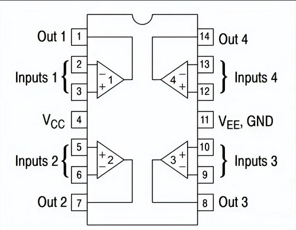
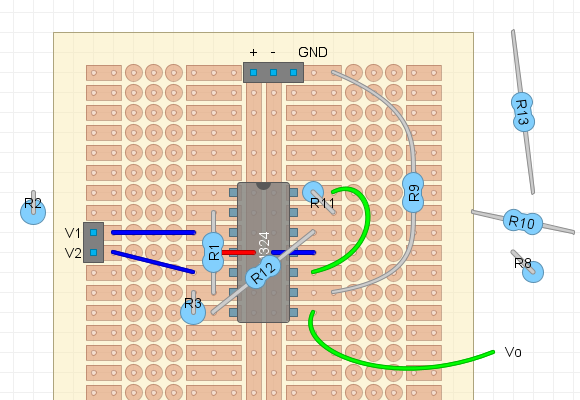

#  Taller de Fabricación 1 de Sistemas Electrónicos
#### Segundo Semestre de 2026

## Objetivo

Construir por grupo un **prototipo inicial en stripboard** de las dos etapas de amplificación estudiadas en [T1](../trabajos/T1.md) y [T2](../trabajos/T2.md), y demostrar su funcionamiento midiendo la ganancia real y el CMRR. Este prototipo permite validar el circuito del proyecto de amplificador de instrumentación de ganancia programable; en este taller se utilizará una ganancia fija y componentes de agujero pasante.

## Materiales y equipamiento

- Stripboard (placa con pistas de cobre paralelas), componentes y valores seleccionados en T1 y T2, zócalos, cables para puentes y conectores.
- Circuito integrado **LM324 de agujero pasante (DIP de 14 pines)** y su zócalo.
- Cautín, estaño, alicates.
- Multímetro, fuente CC con limitación de corriente, generador de funciones y osciloscopio.
- Circuito de prueba de LED con potenciómetro, preparado por el profesor, y LED del color de cada equipo.

## Circuito

Figura 1: Circuito que se construirá en stripboard.

### El LM324 y su alimentación

Como en el [Laboratorio 2](../laboratorio/L2_opamp.md), utilizaremos un **LM324**, que contiene cuatro amplificadores operacionales dentro de un mismo encapsulado. Cada uno tiene una entrada no inversora ($+$), una entrada inversora ($-$) y una salida propias. Utilizaremos tres para el amplificador de instrumentación y el cuarto para la segunda etapa no inversora.

Los cuatro amplificadores comparten internamente los terminales de alimentación: **$V_{CC}$ está en el pin 4 y $V_{EE}$ en el pin 11**. Son dispositivos activos: **es indispensable alimentar ambos pines para que el circuito funcione**, aunque la alimentación no aparezca en cada símbolo del esquema. Identifiquen el pin 1 antes de insertar el integrado y comprueben la alimentación en los pines 4 y 11.

## Preparación y organización

Trabajen en los mismos grupos de T1 y T2.

**Utilicen los valores de resistencias definidos en los Trabajos 1 y 2**, incluyendo $R_G$ (en el circuito fue renombrada a $R_1$), $R_8$, $R_9$ y las resistencias de la primera etapa. El LM324 será el circuito integrado utilizado en este montaje.

Repartan entre los integrantes las tareas de montaje, verificación y preparación de las pruebas.

## Actividad y evaluación (6 pt)

### 1. Montaje y puesta en marcha (2,5 pt)

1. Revisen los valores de las resistencias y la orientación de los circuitos integrados. No es necesario anotar los valores medidos, es apenas para asegurar de que tomaron las resistencias correctas. 

La siguiente imagen muestra una sugerencia de como soldar los componentes en la placa. La imagen muestra una vista superior de la placa, por el lado donde se montan los componentes. Las pistas de cobre estarían hacia abajo en esta vista, pero se muestran como si la placa fuese transparente. 

Se muestra las conexiones del LM324, conector de entrada (V1, V2), conector de alimentación (+, -, GND), la salida (Vo) y las resistencias $R_1$, $R_3$, $R_9$, $R_{11}$ y $R_{12}$. 

2. Suelden los componentes y puentes siguiendo el bosquejo. Identifiquen el prototipo con el color del grupo.
3. Sin alimentación, revisen continuidad, soldaduras y ausencia de cortocircuitos entre alimentación y masa. Alimenten con la tensión y el límite de corriente indicados por el profesor. Con ambas entradas en el mismo voltaje de referencia válido, registren el consumo y el voltaje de reposo de la salida; comprueben que las etapas no estén saturadas.

### 2. Ganancia real (1,5 pt)

1. Mantengan $V_1$ en la referencia y apliquen a $V_2$ una señal sinusoidal pequeña de **50 Hz**, centrada en esa referencia. Atenúen la señal si es necesario para obtener una salida sin recorte. Midan las amplitudes pico a pico en la entrada de la placa y en la salida final.
2. Calculen la ganancia real y compárenla con la ganancia teórica total de T1 y T2:

   $$V_D=V_2-V_1,\qquad |A_D|=\frac{V_{o,pp}}{V_{D,pp}}$$

   $$\text{Error (\%)}=100\frac{|A_D|-A_{D,\mathrm{teo}}}{A_{D,\mathrm{teo}}}$$

### 3. Rechazo de modo común (1,5 pt)

1. Unan las dos entradas y apliquen la misma señal sinusoidal de **50 Hz** a ambas, centrada en la referencia. Mantengan la alimentación y la ganancia anteriores. Pueden aumentar la amplitud respecto de la prueba diferencial, siempre dentro del rango de entrada y sin saturar ninguna etapa.
2. Midan la amplitud de entrada $V_{CM,pp}$ y la componente alterna de salida a 50 Hz $V_{o,CM,pp}$, excluyendo el voltaje DC de reposo. Calculen:

   $$|A_{CM}|=\frac{V_{o,CM,pp}}{V_{CM,pp}},\qquad CMRR_{dB}=20\log_{10}\left(\frac{|A_D|}{|A_{CM}|}\right)$$

   Utilicen la ganancia diferencial medida y amplitudes pico a pico en ambos cocientes. Si la salida no se distingue del ruido, indiquen el límite de amplitud detectable y presenten el CMRR como un límite inferior estimado, usando ese límite en lugar de $V_{o,CM,pp}$; no lo reporten como infinito.

En todas las pruebas, conecten las masas del generador y del osciloscopio a la masa del circuito. Utilicen señales del generador y respeten los rangos de alimentación y entrada.

### 4. Corriente del LED del equipo (0,5 pt)

El profesor dispondrá de un circuito listo para probar un LED del color de cada equipo. Ajusten únicamente el potenciómetro hasta obtener el **brillo mínimo que el grupo considere aceptable**. Midan con el multímetro el voltaje $V_R$ entre los terminales de la resistencia de valor conocido $R$ indicada por el profesor, conectada en serie con el LED, y calculen la corriente resultante:

$$I_{LED}=\frac{V_R}{R}$$

Registren el color del LED, $R$, $V_R$ y la corriente calculada en mA para presentarlos durante la demostración.

## Demostración y presentación de resultados

**No se solicita informe.** Antes de finalizar el taller, presenten el prototipo soldado y demuestren al profesor la amplificación diferencial y el rechazo de modo común. Acompañen la demostración con una tabla breve, en papel o pantalla, que incluya alimentación, consumo, voltaje de reposo, amplitudes medidas, ganancia teórica y real, error porcentual y CMRR a 50 Hz, además de los resultados de la prueba del LED. Expliquen brevemente las diferencias con lo esperado y las correcciones realizadas.
