# Técnicas de Fabricación y Prototipaje en Electrónica

En el primer taller de fabricación se montarán las etapas de amplificación de la Placa 1 del proyecto de amplificador de instrumentación de ganancia programable. Se utilizarán componentes de **agujero pasante**, soldados manualmente con cautín. Después del montaje se comprobarán las conexiones y se medirán la ganancia real y el rechazo de modo común (CMRR).

<!-- vscode-markdown-toc -->
* 1. [ 1. Tarjeta de Circuito Impreso (PCB - Printed Circuit Board)](#1.TarjetadeCircuitoImpresoPCB-PrintedCircuitBoard)
	* 1.1. [Ejemplos](#Ejemplos)
	* 1.2. [Materia Prima](#MateriaPrima)
	* 1.3. [Proceso de Fabricación de la Placa](#ProcesodeFabricacindelaPlaca)
		* 1.3.1. [Versión Casera](#VersinCasera)
		* 1.3.2. [Soldadura de Componentes](#SoldaduradeComponentes)
		* 1.3.3. [Versión Industrial](#VersinIndustrial)
* 2. [Circuitos Integrados](#CircuitosIntegrados)
	* 2.1. [Encapsulados](#Encapsulados)
* 3. [Resúmen: Conceptos Clave](#Resmen:ConceptosClave)

<!-- vscode-markdown-toc-config
	numbering=true
	autoSave=true
	/vscode-markdown-toc-config -->
<!-- /vscode-markdown-toc -->

##  1.  1. Tarjeta de Circuito Impreso (PCB - Printed Circuit Board)

###  1.1. Ejemplos

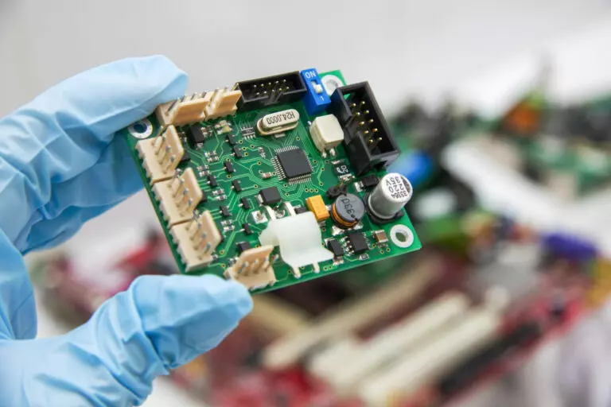

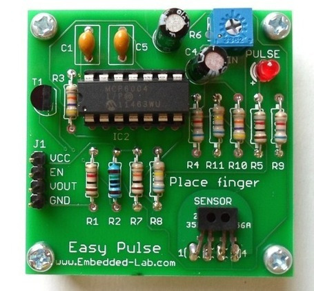

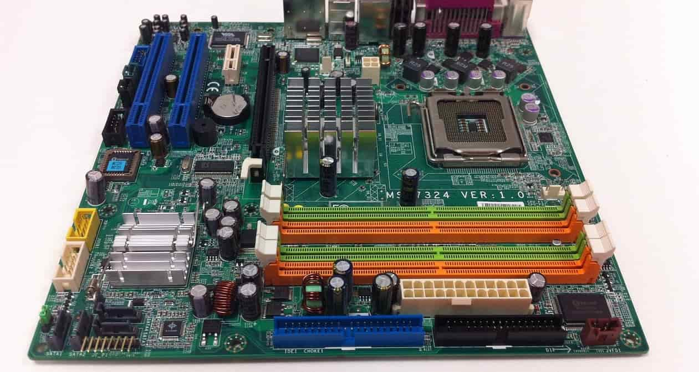

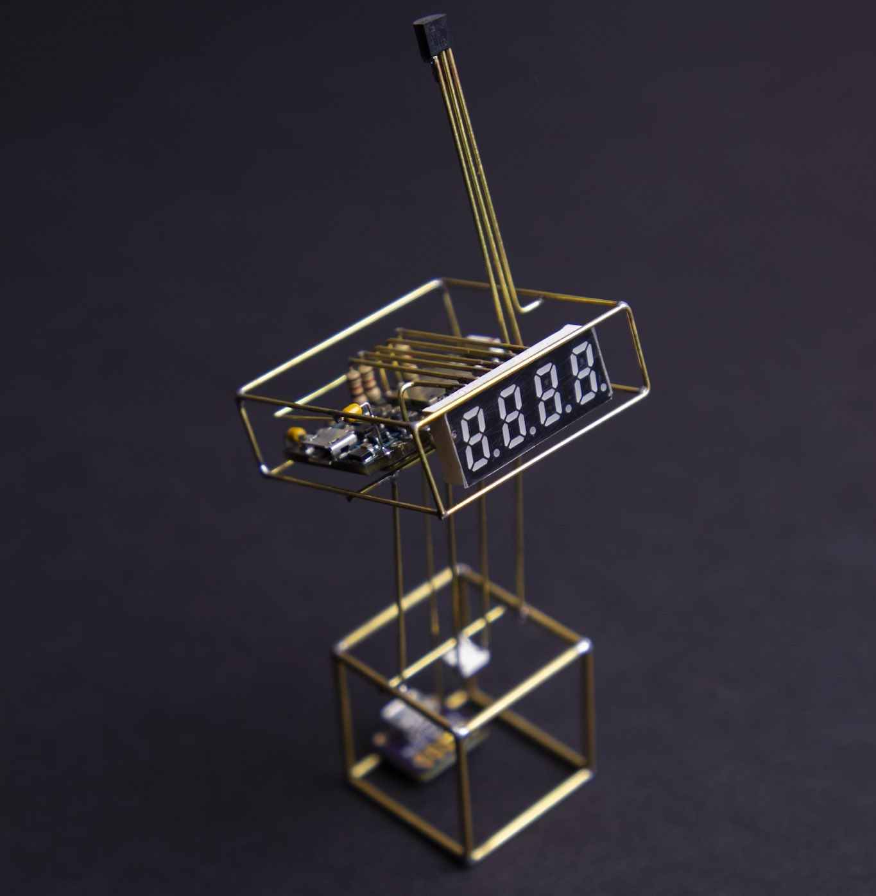

###  1.2. Materia Prima

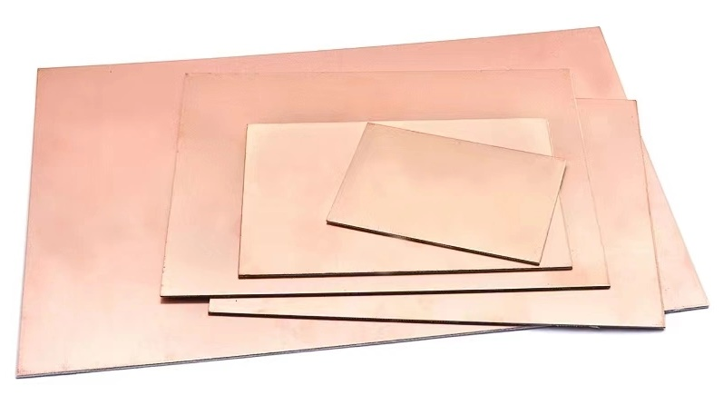

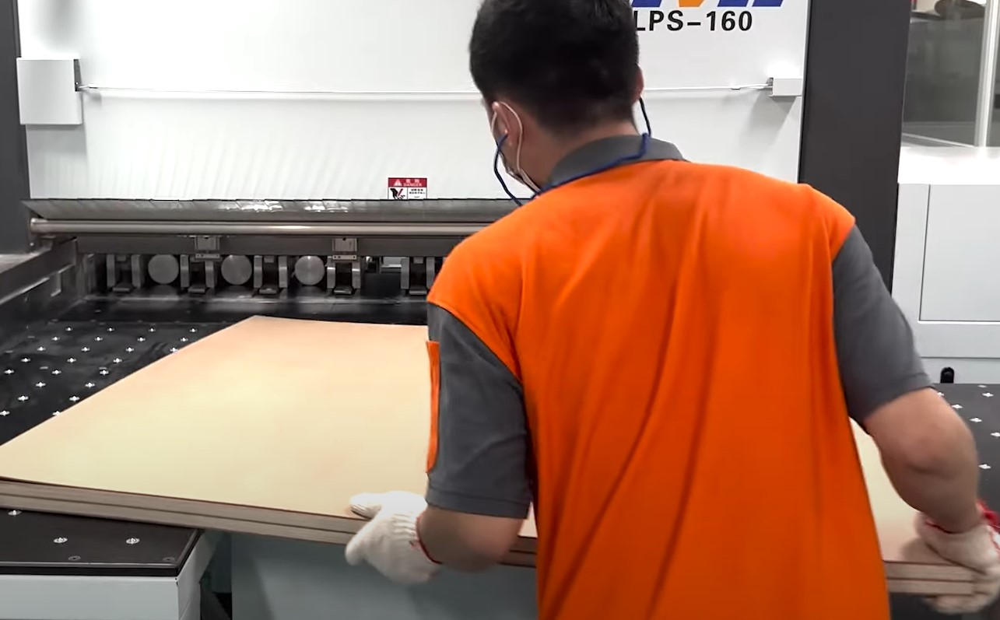

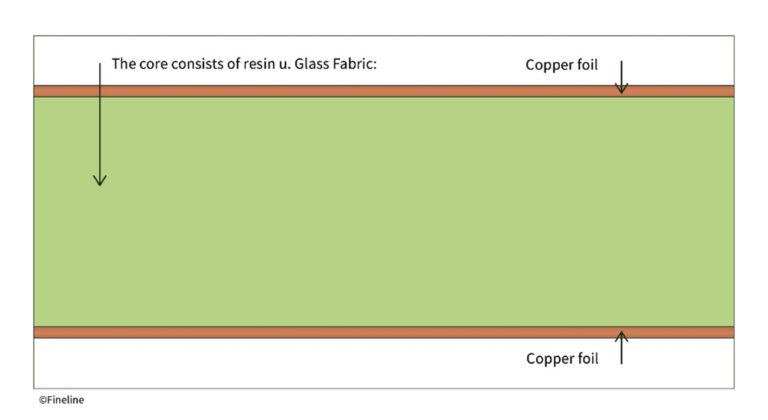

###  1.3. Proceso de Fabricación de la Placa

####  1.3.1. Versión Casera

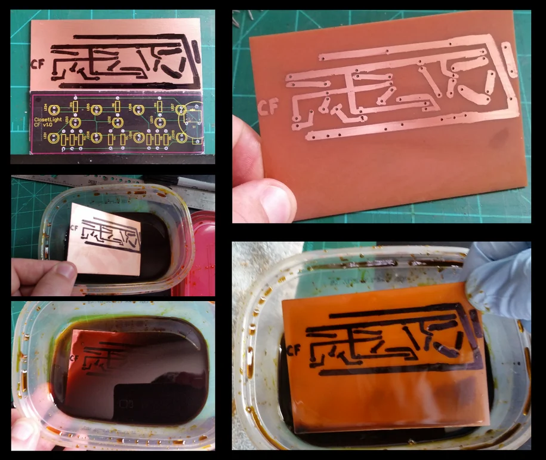

####  1.3.2. Soldadura de Componentes

[Soldadura punto a punto](https://www.youtube.com/watch?v=rK38rpUy568&t=167s)

[tips para soldar](https://www.youtube.com/shorts/D5IvlJVqa7M)

En el montaje de agujero pasante, los terminales atraviesan los orificios de la PCB y se sueldan a sus pads. Calienten simultáneamente el pad y el terminal con el cautín, aporten estaño a la unión y eviten puentes entre pads vecinos. Recorten los terminales sobrantes y revisen cada unión antes de alimentar la placa.

Comprueben los valores de las resistencias antes de soldarlas y respeten la orientación de los circuitos integrados y la polaridad de los componentes que corresponda. Con la placa sin alimentación, utilicen el multímetro para verificar continuidad y descartar cortocircuitos entre alimentación y masa.

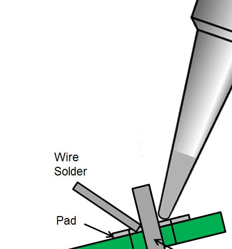

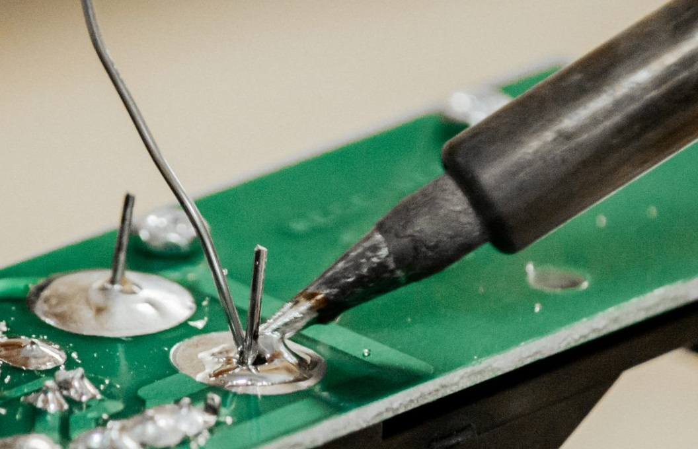

####  1.3.3. Versión Industrial

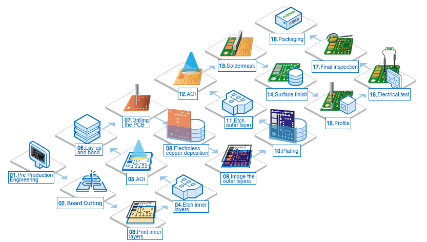

Fotolitografia

[fuente](https://www.pcbway.com/pcb-service.html)

##  2. Circuitos Integrados

###  2.1. Encapsulados

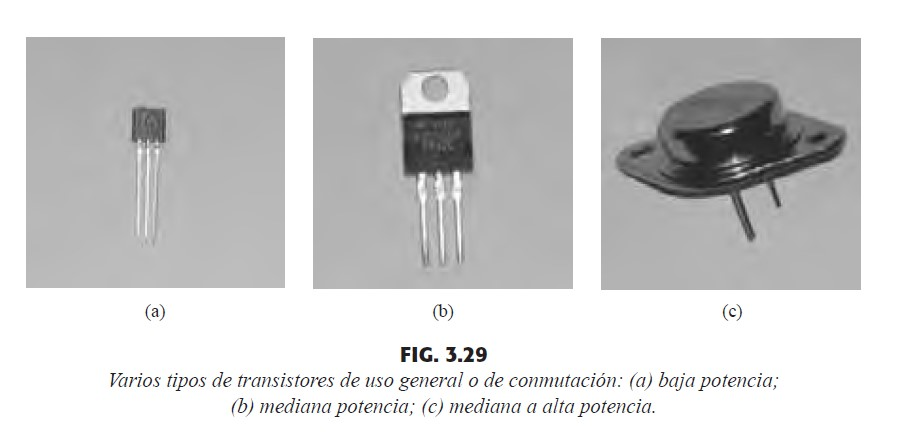

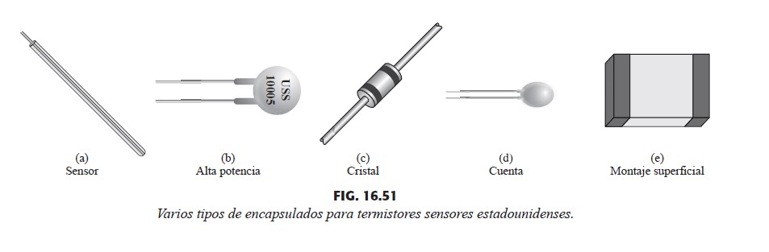

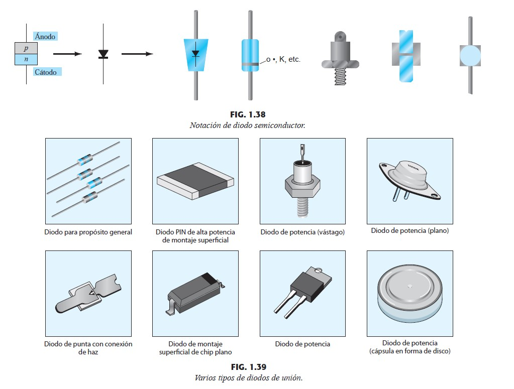

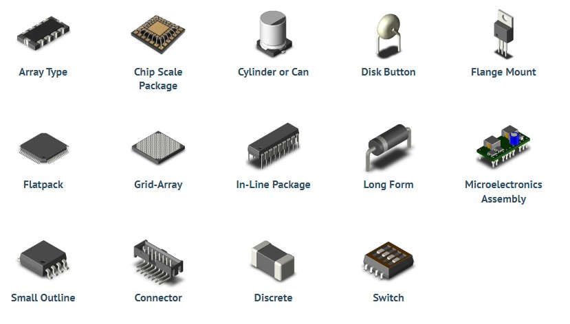

Para este taller se utilizarán encapsulados de agujero pasante (Through-Hole). Identifiquen el pin 1 y la orientación del encapsulado antes de insertar cada circuito integrado en su zócalo.

##  3. Resúmen: Conceptos Clave

- Tarjeta de Circuito Impreso (PCB)
- Fotolitografia
- Circuito Integrado
- Agujero Pasante
- Soldadura con cautín
- Verificación de continuidad y ausencia de cortocircuitos
- Ganancia diferencial y rechazo de modo común (CMRR)
