# Taller F1: del montaje punto a punto al prototipo soldado

En este taller se construirá un **prototipo inicial en stripboard** del amplificador de instrumentación, con ganancia fija y componentes de agujero pasante. La demostración incluirá la ganancia real y el rechazo de modo común (CMRR). El recorrido siguiente permite comparar las formas de conectar componentes y elegir una distribución que facilite el montaje y las pruebas.

## Antes de los circuitos impresos

En el montaje **punto a punto**, los terminales de los componentes se conectan directamente o mediante cables y soportes, sin una placa con pistas diseñadas para el circuito. Esta técnica precede al uso de circuitos impresos y también puede emplearse en construcciones actuales.

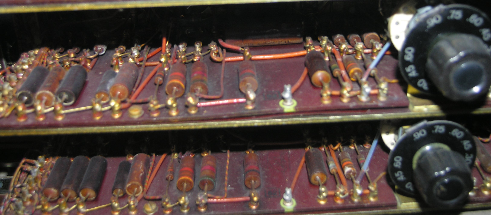

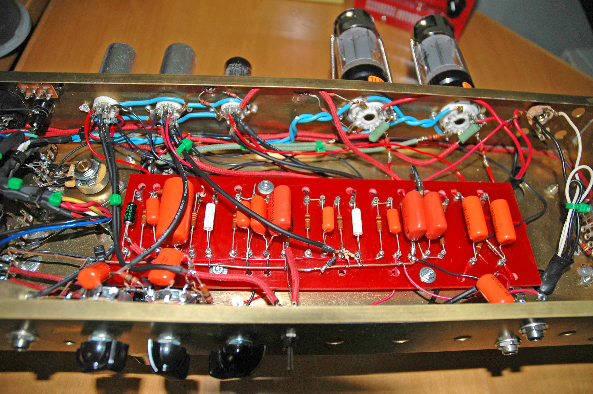

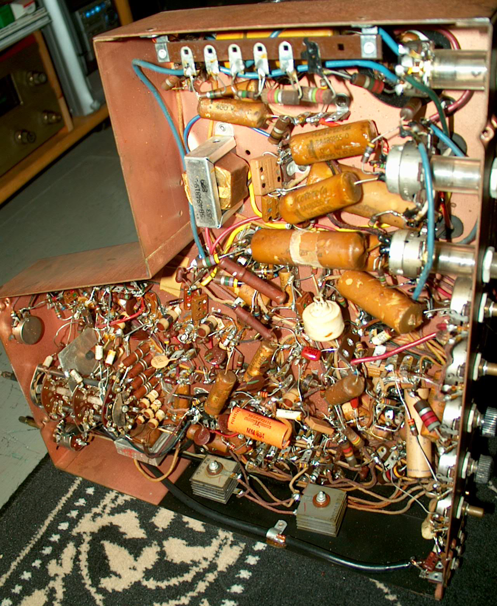

Los ejemplos muestran distintos grados de organización y complejidad. Al aumentar el número de conexiones, resulta más difícil seguir el circuito, localizar errores y reproducir el montaje. La automatización y la fabricación en cantidad también se dificultan; la resistencia a movimientos depende de cómo se sujeten los componentes y cables.

## Prueba de concepto: protoboard

La **protoboard** permite conectar componentes sin soldadura y modificar rápidamente el circuito. Es útil para comprobar una etapa antes de pasar a un montaje permanente.

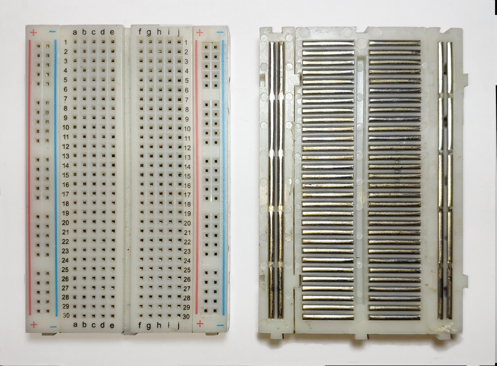

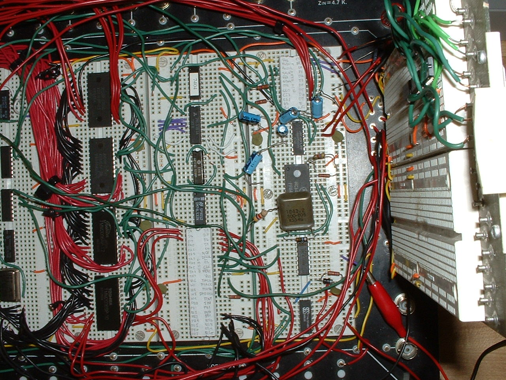

Su facilidad de modificación tiene límites: los contactos pueden ser poco confiables, los cables pueden soltarse y aparecen capacitancias parásitas. Un montaje extenso se vuelve difícil de revisar, replicar y transportar. En F1 se puede utilizar como apoyo para resolver una conexión dudosa; no se exige montar el circuito completo dos veces.

## Prototipado con conexiones soldadas

### Perfboard: placa perforada

La **perfboard** ofrece orificios para insertar componentes. Según el modelo, puede tener pads de cobre aislados o carecer de cobre; las conexiones se realizan con cables, terminales o puentes de soldadura.

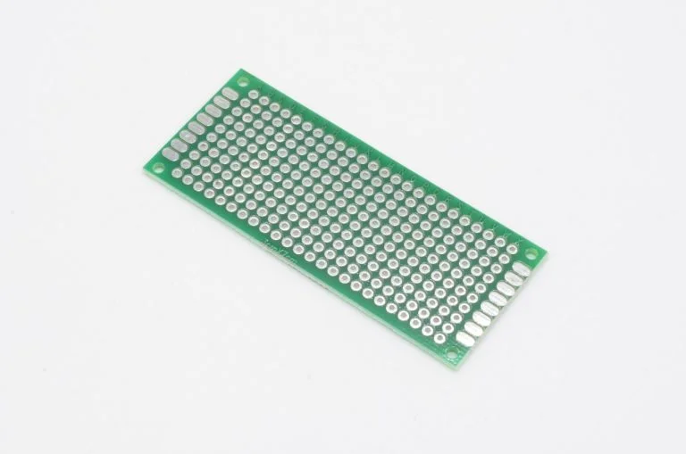

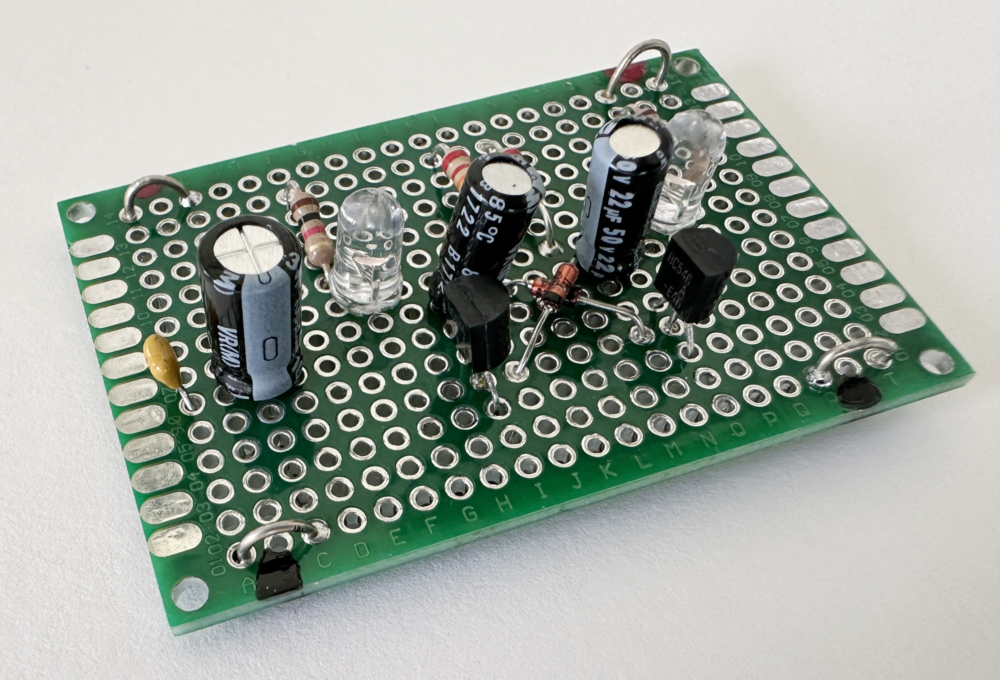

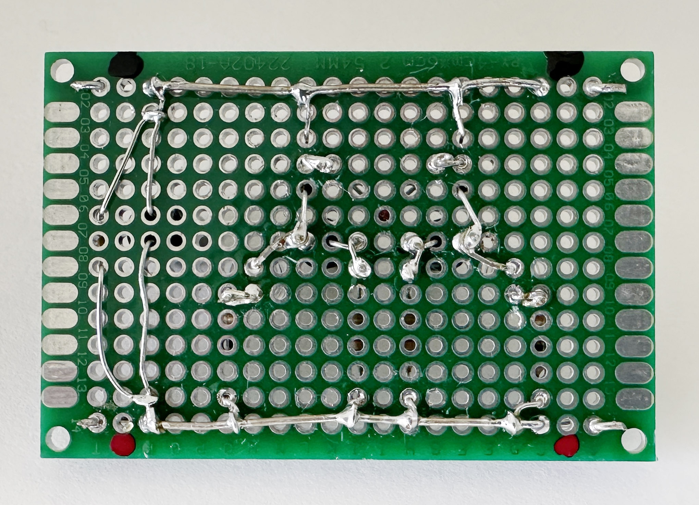

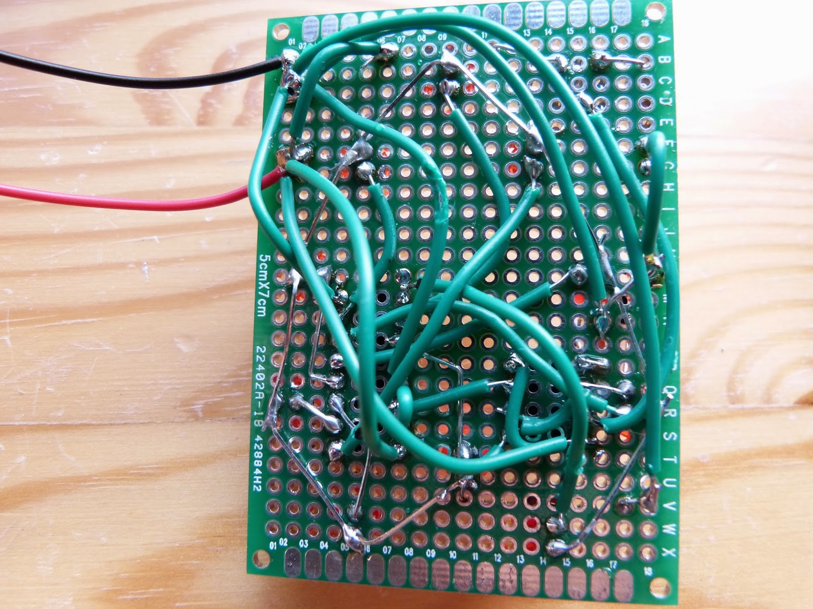

La soldadura permite un montaje más estable que los contactos de una protoboard. Se evita fabricar una PCB específica, pero el cableado sigue siendo manual y depende de la distribución elegida. Los tamaños y la separación entre orificios son predeterminados, y producir muchas unidades resulta laborioso.

### Stripboard: placa con pistas paralelas

La **stripboard** tiene orificios unidos por pistas de cobre paralelas. Estas pistas reducen la necesidad de cables respecto de una placa con pads aislados, pero deben cortarse donde sea necesario separar nodos.

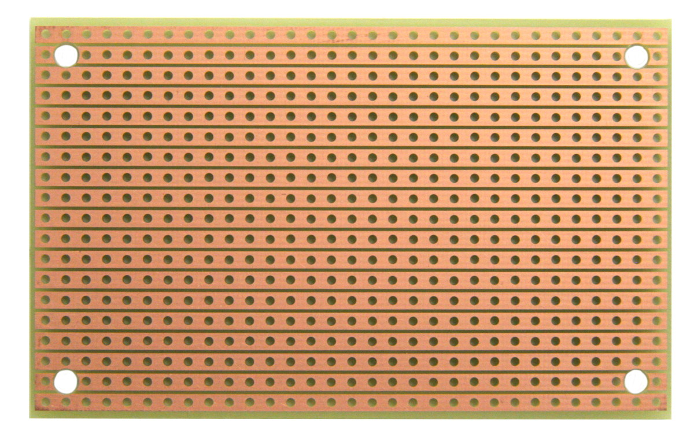

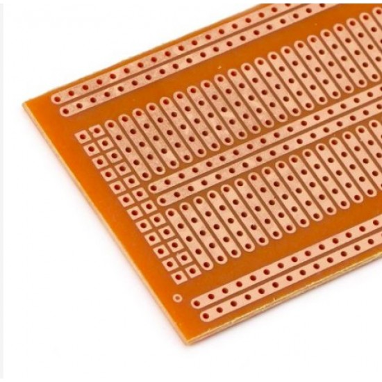

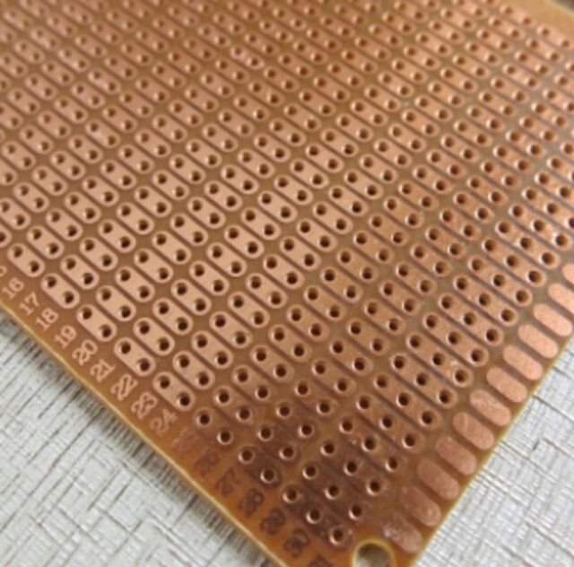

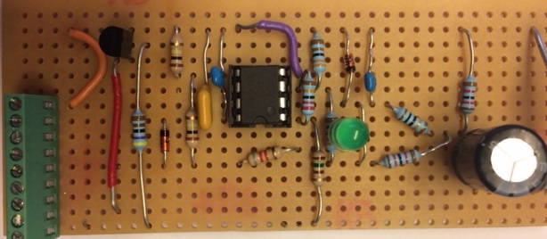

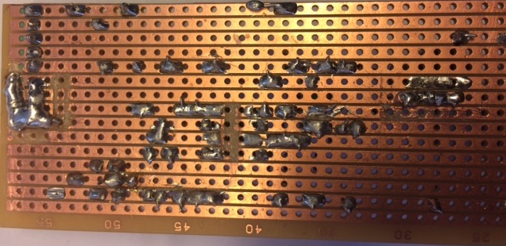

Antes de soldar, dibujen la posición de los componentes, los puentes y los cortes. Presten atención a las pistas que pasan bajo los zócalos: no deben unir terminales que pertenecen a nodos distintos. Comprueben cada corte con el multímetro y dejen accesibles los puntos de prueba. Es una solución práctica para el prototipo inicial, aunque su montaje manual también limita la repetición en cantidad.

## Soldadura de componentes de agujero pasante

Los terminales atraviesan los orificios de la placa y se sueldan al cobre. Calienten simultáneamente el terminal y el pad con el cautín, aporten estaño a la unión y eviten puentes entre pistas vecinas. Recorten los terminales sobrantes y revisen las uniones.

[Demostración de soldadura punto a punto](https://www.youtube.com/watch?v=rK38rpUy568&t=167s)

[Consejos para soldar](https://www.youtube.com/shorts/D5IvlJVqa7M)

Comprueben los valores de las resistencias antes de soldarlas y respeten la orientación y polaridad de los componentes. Identifiquen el pin 1 de cada circuito integrado. Con el prototipo sin alimentación, revisen continuidad y ausencia de cortocircuitos entre alimentación y masa.

## Conceptos clave

- Montaje punto a punto, protoboard, perfboard y stripboard.
- Compromiso entre facilidad de modificación, estabilidad y repetibilidad.
- Componentes de agujero pasante y soldadura con cautín.
- Distribución de componentes, cortes de pista, puentes y puntos de prueba.

La [introducción de F2](F2_fab_II_intro.md) presenta el paso a las PCB específicas y otras técnicas de montaje.
