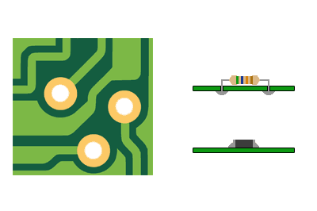

# Taller F2: circuitos impresos y montaje superficial

Después del prototipo inicial de F1, esta introducción aborda las **placas de circuito impreso (PCB)** y la **soldadura de componentes de montaje superficial**, que se incorporará en el segundo taller. Es importante distinguir la fabricación de la placa del montaje de sus componentes.

## Del prototipo a una PCB específica

Una PCB proporciona soporte mecánico y conexiones mediante pistas de cobre diseñadas para el circuito. Frente al cableado manual, permite repetir la distribución y las conexiones, y facilita el montaje de varias unidades.

Los ejemplos abarcan desde un circuito compacto de medición hasta una placa con numerosos componentes y conectores. La complejidad del diseño y del montaje cambia, aunque en todos los casos se deben definir conexiones, alimentación y puntos de acceso para las pruebas.

Como contraste, también existen construcciones **sin placa**, en las que los conductores forman parte del soporte y de la apariencia del circuito:

Comparen estos extremos: ¿qué construcción facilita la inspección, el transporte, la reparación y la fabricación de muchas unidades? Una solución visualmente atractiva no necesariamente resulta fácil de reproducir.

## Materia prima de una PCB

La placa parte de un sustrato aislante recubierto de cobre. Un material habitual es **FR4**, formado por fibra de vidrio y resina. El cobre se conserva donde se necesitan conexiones y se elimina donde se requiere aislamiento.

## Fabricación de la placa

### Versión casera

Se protege el cobre que formará las pistas y se elimina el cobre expuesto mediante ataque químico. Luego se limpia la placa y se realizan las perforaciones necesarias. La calidad de la transferencia del patrón y del ataque afecta la continuidad y separación de las pistas.

### Versión industrial

La fabricación industrial utiliza procesos controlados para definir las pistas, perforar, conectar capas cuando corresponde y aplicar acabados. La **fotolitografía** permite transferir un patrón mediante material fotosensible. La máscara de soldadura deja accesibles los pads y la serigrafía ayuda a identificar los componentes.

[Recurso sobre fabricación de PCB](https://www.pcbway.com/pcb-service.html)

## Encapsulados y formas de montaje

El encapsulado define la forma física del componente y la disposición de sus terminales. Un mismo tipo de componente puede ofrecerse en distintos encapsulados; antes de montarlo deben coincidir el componente, su orientación y la huella de la placa.

En el montaje de **agujero pasante**, los terminales atraviesan la placa. En el **montaje superficial (SMD)**, los terminales se sueldan a pads en la superficie. Este último permite montajes compactos, pero requiere mayor precisión al colocar, soldar e inspeccionar los componentes.

## Soldadura de montaje superficial

En F2 se introducirá la soldadura de componentes SMD. La técnica y los materiales se elegirán según los componentes y el equipamiento del taller.

- **Con cautín:** posicionar el componente, fijar un terminal y soldar los restantes con ayuda de flux, revisando alineación y puentes de estaño.
- **Por refusión:** depositar pasta de soldadura en los pads, mediante stencil cuando corresponda, colocar los componentes y aplicar un ciclo térmico adecuado a la pasta y los componentes.

Antes de calentar, comprueben orientación, polaridad y pin 1. Después, inspeccionen las uniones, busquen puentes o terminales sin soldar y comprueben continuidad y ausencia de cortocircuitos antes de alimentar.

En producción, la colocación puede automatizarse mediante máquinas **pick and place**. La colocación del componente y la soldadura son operaciones distintas.

[Ejemplo de montaje de componentes](https://www.youtube.com/watch?v=24ehoo6RX8w)

[Ejemplo de colocación automatizada: pick and place](https://www.youtube.com/watch?v=S8qkaTsr2_o&t=32s)

## Conceptos clave

- PCB, pistas, pads, sustrato FR4, máscara de soldadura y serigrafía.
- Fabricación casera e industrial; fotolitografía.
- Encapsulado, huella, agujero pasante y montaje superficial.
- Soldadura con cautín, pasta de soldadura, stencil, refusión e inspección.

La [introducción de F3](F3_fab_III_intro.md) aborda cómo se fabrica el circuito integrado que se monta sobre la placa.
