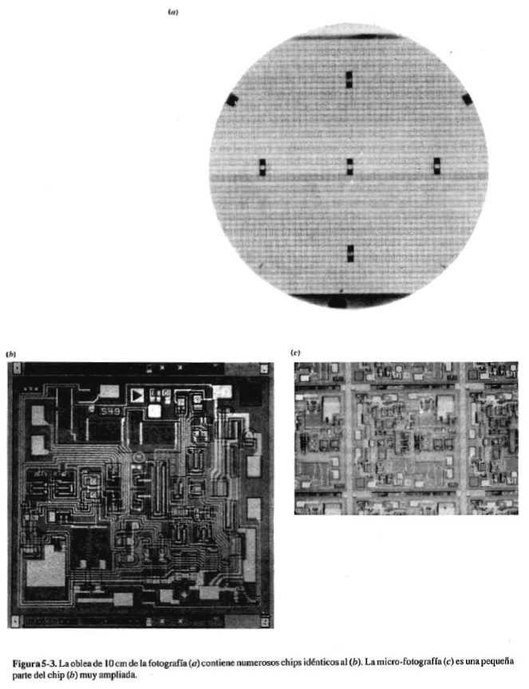
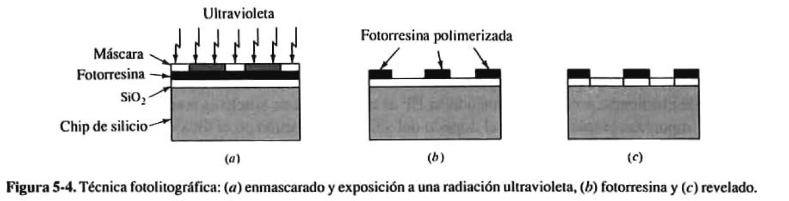
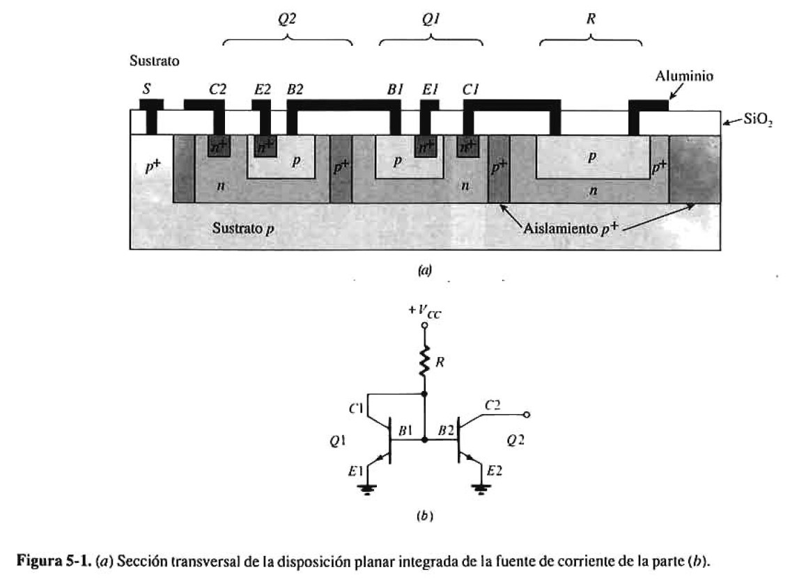
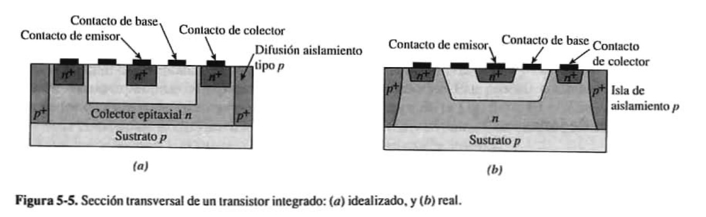
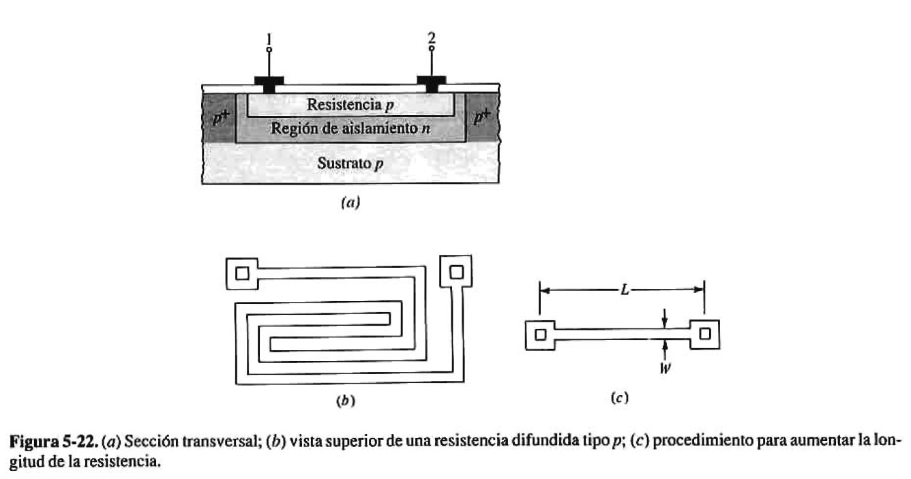

# Taller F3: fabricación de circuitos integrados

En [F1](F1_fab_I_intro.md) se compararon técnicas de prototipado y en [F2](F2_fab_II_intro.md), la fabricación de PCB y el montaje de sus componentes. Aquí se presenta una escala distinta: la fabricación de los dispositivos **dentro de un circuito integrado**. Este material sirve como contexto para comprender los componentes utilizados en el proyecto.

## De la placa al circuito integrado

Una PCB conecta componentes mediante pistas de cobre. Un circuito integrado reúne dispositivos y conexiones sobre un pequeño fragmento de semiconductor, llamado **die**, que se protege y conecta al exterior mediante un encapsulado. Fabricar la PCB, fabricar el circuito integrado y soldar su encapsulado a la placa son procesos diferentes.

## Obleas y fotolitografía

Los circuitos integrados se fabrican sobre **obleas (wafers)** de semiconductor. Una oblea contiene numerosos circuitos que, después de su fabricación y prueba, se separan y encapsulan.

La **fotolitografía** define patrones mediante material fotosensible. Se combina con otras etapas de fabricación para formar regiones, capas y conexiones. Se realizan varias secuencias de proceso: el circuito completo no se obtiene con una única exposición.

El principio de transferir patrones también aparece en la fabricación de PCB, pero los materiales, las dimensiones y los procesos empleados son distintos.

## Dispositivos y circuitos integrados en el semiconductor

Las siguientes imágenes relacionan elementos del esquema eléctrico con estructuras físicas y ejemplos de circuitos integrados.

### Fuente de corriente

Una función que en un montaje discreto requiere varios componentes puede formar parte de un circuito integrado. Esto permite reducir conexiones externas y reproducir estructuras en un mismo proceso de fabricación.

### Transistor bipolar

El corte transversal muestra cómo las regiones del semiconductor forman el dispositivo. El símbolo de un transistor en el esquema representa una estructura física, cuyas características dependen de su geometría y fabricación.

### Resistencia integrada

También pueden fabricarse resistencias dentro del circuito integrado. Sus características dependen del material y la geometría, y presentan tolerancias que deben considerarse en el diseño.

## Relación con el proyecto

Los amplificadores operacionales utilizados en el amplificador de instrumentación contienen internamente transistores, fuentes de corriente, resistencias y otras estructuras. Su comportamiento real depende de esa implementación: tensión de offset, ruido, corriente de entrada y rechazo de modo común son parámetros que afectan las mediciones del prototipo.

Al comparar cálculo y medición, consideren tanto las limitaciones del circuito integrado como las tolerancias de los componentes externos y la calidad del montaje. Un error de cableado o una soldadura deficiente puede impedir el funcionamiento aunque los componentes elegidos sean adecuados.

## Conceptos clave

- Circuito integrado, die, oblea y encapsulado.
- Fotolitografía y formación de estructuras en el semiconductor.
- Transistores, resistencias y fuentes de corriente integrados.
- Diferencia entre fabricación del circuito integrado, fabricación de la PCB y montaje.
