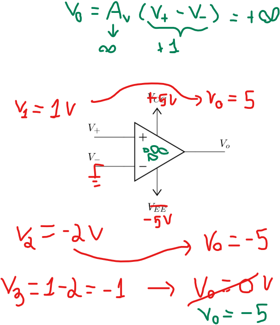
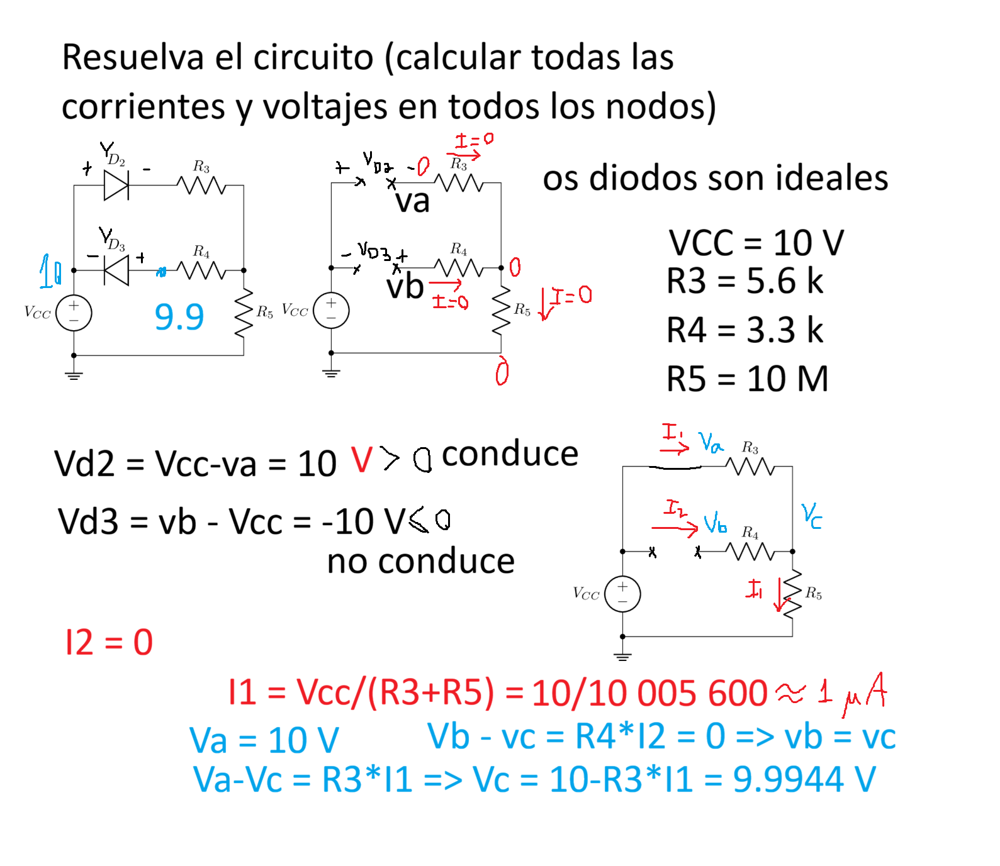
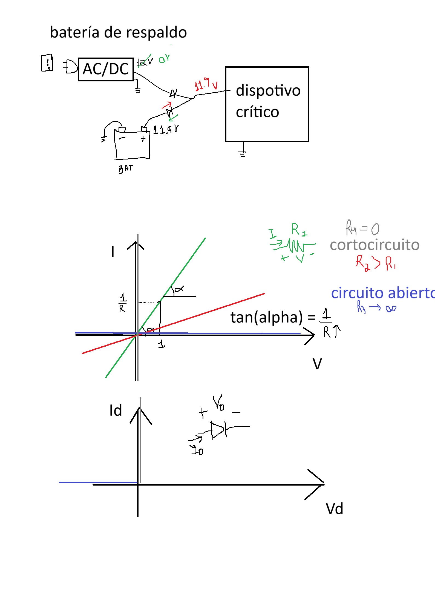
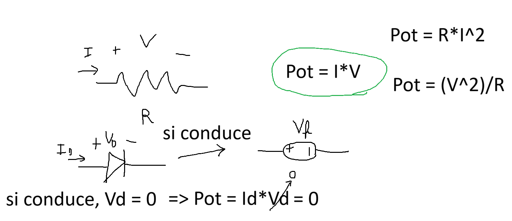

# Diodos y Aplicaciones

## Introducción

En esta clase empezamos el análisis de 2 componentes electrónicos no-lineales. Hasta el momento habíamos utilizado elementos electrónicos con comportamiento lineal: si la salida vale Y1 cuando la entrada es X1, e Y2 cuando la entrada es X2, entonces la salida para X1+X2 es simplemente Y1+Y2. Sin embargo, para elementos no-lineales esta regla no necesariamente se cumple.

Un primer caso de no-linealidad que ya estudiamos es el uso del amplificador operacional sin retroalimentación negativa; por ejemplo como un comparador:

A continuación estudiaremos un componente no-lineal llamado diodo.

## Símbolo, nomenclatura y convenciones

## Diodo Ideal

$$ 
\left\{ 
    \begin{array}{ c l }
        \textrm{conduce }(I_D>0) & \quad \textrm{si } V_D > 0 \\
        \textrm{no conduce }(I_D=0)                 & \quad \textrm{si } V_D \leq 0
    \end{array} 
\right.
$$

## Cómo analisar un circuito con diodos

1. remover el diodo del circuito
2. Calcular $V_D$
   - Si $V_D \leq 0 $, el diodo no conduce, y por lo tanto se comporta como un circuito abierto
   - Si $V_D > 0$, el diodo coduce, y por lo tanto lo reemplazamos por un corto-circuito

## Aplicaciones
- Rectificador de media onda
- Rectificador de onda completa
- Batería de respaldo

## Modelo mejorado

$$ 
\left\{ 
    \begin{array}{ c l }
        \textrm{conduce }(I_D>0) & \quad \textrm{si } V_D > V_f \\
        \textrm{no conduce }(I_D=0)                 & \quad \textrm{si } V_D \leq V_f
    \end{array} 
\right.
$$

La tensión de polarización en directa ($V_f$) es una constante para cada diodo. Depende del material y forma de construcción, y es usualmente 0,7V para diodos de silício

## Cómo analisar un circuito con diodos utilizando el modelo mejorado

1. remover el diodo del circuito
2. Calcular $V_D$
   - Si $V_D \leq V_f $, el diodo no conduce, y por lo tanto se comporta como un circuito abierto
   - Si $V_D > V_f$, el diodo coduce, y por lo tanto lo reemplazamos por una fuente de voltaje de $V_f$ voltios.

## Ejercicio

## LEDs

LED en realidad no es una palabra, sino que una sigla: Light-Emitting Diode, que significa Diodo Emisor de Luz. La diferencia entre un LED y un diodo convencional es que el diodo convencional disipa la energía eléctrica convirtiendola en energia térmica (calor), mientras que el LED convierte la energia eléctrica en luz. 

Tipicamente los $V_f$ de los LEDs son más grandes que los de los diodos convencionales (por ejemplo, 2.2 V, 3.5 V). Otra diferencia es que los LEDs no están proyectados para resistir a voltajes inversos altos, entonces se queman facilmente al aplicar un $V_f$ negativo (por ejemplo menos de -5 V).

## Bibliografia

Boylestad, R. & Nashelsky, L. (2009). Electrónica: Teoría de circuitos y dispositivos electrónicos (10ma.ed.). 

### Capítulos
- Capítulo 1, sesiones 1.7, 1.9, 1.13 y 1.16
- Capítulo 2, sesiones 2.3, 2.4, 2.6, 2.7, 2.12

### Ejercícios Recomendados
- Capítulo 1
  - Sesión 1.7: ej 23
- Capítulo 2
  - Sesíon 2.3: ejs 5, 6, 8
  - Sesión 2.4: ejs 10, 13
  - Sesión 2.6: ejs 22, 23, 24, 25, 26, 27
  - Sesión 2.7: ejs 28, 29, 30, 31
