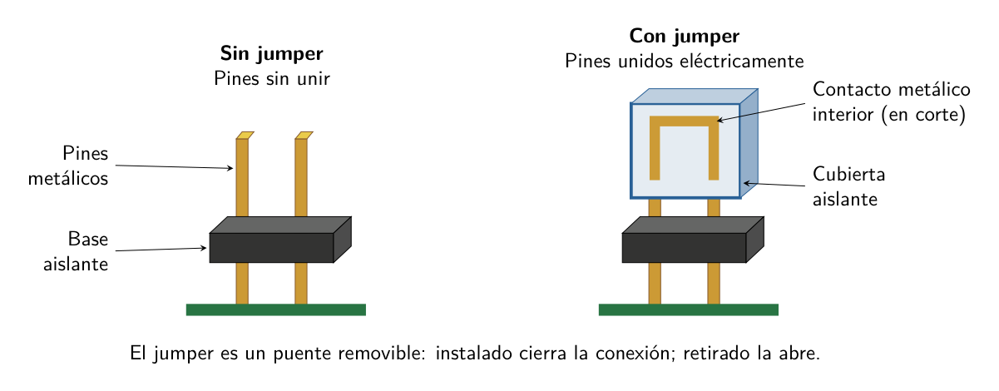

#  Trabajo 4 de Sistemas Electrónicos

#### Segundo Semestre de 2026

## Introducción

Durante este semestre, cada grupo diseñará y fabricará un **amplificador de instrumentación de ganancia programable**, compuesto por el amplificador (placa 1), el visualizador (placa 2) y la fuente de poder y configuración (placa 3).

En los Trabajos 1 y 2 se diseñaron dos etapas de amplificación con ganancia fija. En este trabajo incorporarán **interruptores analógicos en la placa 1 para cambiar sus ganancias** y analizarán cómo la placa 3 permite elegirlas mediante jumpers y MOSFET.

Las señales **$A0$, $A1$, $B0$, $C0$ y $C1$ son entradas de control de la placa 1**: cambian sus conexiones internas y, con ello, su funcionamiento. Están diseñadas para adoptar sólo dos niveles de voltaje: uno **bajo**, cercano a $-2{,}5\,\text{V}$, y otro **alto**, cercano a $+2{,}5\,\text{V}$. No son las señales analógicas que se desean amplificar. $A0$ y $A1$ controlan conjuntamente el selector del INA; $B0$ controla el de la segunda etapa. $C0$ y $C1$ controlan otras opciones de la placa 1, asociadas a los filtros que se estudiarán posteriormente. En este trabajo deducirán qué ganancia produce cada estado de $A0$, $A1$ y $B0$.

Consideren disponibles los rieles **$V_{CC}=+2{,}5\,\text{V}$ y $V_{EE}=-2{,}5\,\text{V}$**, con $0\,\text{V}$ como referencia de las señales analógicas. La regulación de voltaje no se diseña en este trabajo.

El ensayo deberá incluir la identificación del grupo y de sus integrantes, las ecuaciones utilizadas, los valores elegidos con sus unidades y las referencias consultadas.

## 1. Ganancia programable en la placa 1 (1,8 pt)

### Interruptores analógicos

Un **interruptor analógico** permite abrir o cerrar el paso de una señal eléctrica mediante una entrada de control de dos niveles. Puede conducir en ambos sentidos dentro de su rango de voltajes; la señal que atraviesa el interruptor no tiene que ser sólo alta o baja. Estos dispositivos se implementan con transistores MOSFET: una realización habitual combina un NMOS y un PMOS en paralelo, controlados de forma complementaria. Pueden reconocer esa estructura en el diagrama interno de un interruptor de la [hoja de datos del 74HC4052D](https://assets.nexperia.com/documents/data-sheet/74HC_HCT4052.pdf).

El **74HC4052D** contiene dos selectores de cuatro posiciones que comparten las entradas $S0$ y $S1$. Cada selector conecta su terminal común $nZ$ a uno de $nY0$, $nY1$, $nY2$ o $nY3$. El **74HC4053D** contiene tres selectores de dos posiciones; cada uno conecta su común $nZ$ a $nY0$ o $nY1$. Consulten sus tablas de funcionamiento para establecer qué conexión corresponde a cada nivel de control: [74HC4052D](https://assets.nexperia.com/documents/data-sheet/74HC_HCT4052.pdf) y [74HC4053D](https://assets.nexperia.com/documents/data-sheet/74HC_HCT4053.pdf).

Para los dos integrados de este ejercicio, conecten su alimentación positiva a $V_{CC}$ y sus terminales **GND y VEE a $V_{EE}$**. Mantengan **E/INH en nivel bajo, conectado a $V_{EE}$**, para habilitar los selectores. El terminal llamado GND en estos integrados es la referencia de sus controles; en esta conexión está a $-2{,}5\,\text{V}$, no a la referencia analógica de $0\,\text{V}$. Las conexiones de alimentación y habilitación se omiten en los diagramas funcionales siguientes.

En las preguntas 1 y 2, consideren operacionales ideales en régimen lineal e **interruptores analógicos ideales**, con resistencia nula cuando están cerrados. La resistencia de conducción real se estudiará en un análisis posterior.

### Primera etapa: INA

En el INA de T2 se sustituyen las dos resistencias de realimentación de los operacionales de entrada por redes seleccionables. Cada red permite conectar entre la **entrada inversora** y la **salida de su operacional** una resistencia de $0$, $100\,\text{k}\Omega$, $200\,\text{k}\Omega$ o $300\,\text{k}\Omega$. Los dos selectores pertenecen al mismo 74HC4052D y cambian simultáneamente con $S0=A0$ y $S1=A1$.

Figura 1: INA con realimentación seleccionable y amplificador de diferencias de T2. Los puertos rotulados $V_A$ y $V_B$ representan los mismos nodos en ambas partes del dibujo. La etapa de diferencias, formada por el tercer operacional y $R_{10}$–$R_{13}$, produce $v_{\mathrm{INA}}=V_B-V_A$. [Código circuitikz](circuitos_propuestos/T4_INA_programable.tex).

Utilicen $R_1=R_G=1\,\text{k}\Omega$, el valor disponible seleccionado para el INA en T2, y $R_2=R_3=R_4=R_5=R_6=R_7=100\,\text{k}\Omega$. Para el amplificador de diferencias, $R_{10}=R_{11}=R_{12}=R_{13}=100\,\text{k}\Omega$, como en T2. Las designaciones $1Z$, $2Z$ y $nYk$ corresponden a las de la hoja de datos. En la Figura 1, las conexiones internas de cada selector se determinan mediante su tabla de funcionamiento.

1. Completen la tabla de **ganancia del INA en función de sus dos entradas de control**, definiendo $A_{\mathrm{INA}}=v_{\mathrm{INA}}/(V_2-V_1)$. **(1,0 pt)**

    | $A1$ | $A0$ | Terminal conectado a cada común | Resistencia de realimentación de cada operacional | $A_{\mathrm{INA}}$ |
    |---|---|---|---|---|
    | Bajo | Bajo | | | |
    | Bajo | Alto | | | |
    | Alto | Bajo | | | |
    | Alto | Alto | | | |

### Segunda etapa

En la segunda etapa se conserva $R_8$ entre la salida y la entrada inversora. Una sección del 74HC4053D selecciona si la rama de $R_9$ queda conectada a esa entrada. Su común $3Z$ se conecta a la entrada inversora, $3Y0$ queda sin conexión y $3Y1$ se conecta a $R_9$, cuyo otro extremo está a **$0\,\text{V}$**. La entrada de selección es $S3=B0$.

Figura 2: Selección de la segunda etapa mediante $B0$. Utilicen los valores de $R_8$ y $R_9$ elegidos y corregidos en T1/T2. [Código circuitikz](circuitos_propuestos/T4_segunda_etapa_programable.tex).

La entrada inversora es un terminal de señal distinto del pin de alimentación negativa $V_{EE}$. Tampoco se abre toda la realimentación: $R_8$ permanece conectada en ambas posiciones del selector.

2. Completen la tabla de **ganancia de la segunda etapa en función de $B0$**, definiendo $A_2=v_o/v_i$. **(0,8 pt)**

    | $B0$ | Terminal conectado a $3Z$ | Ganancia $A_2$ |
    |---|---|---|
    | Bajo | | |
    | Alto | | |

## 2. Selección de las ganancias mediante jumpers (1,2 pt)

### Selección de la ganancia en la placa

Un **jumper** es un pequeño puente removible que une eléctricamente dos pines de un **pin header** (una hilera de pines metálicos fijados a la placa). Tiene una cubierta aislante y un contacto metálico interior: al colocarlo sobre dos pines, cierra la conexión entre ellos; al retirarlo, la abre. Se utiliza para configurar un circuito sin tener que soldar o desoldar conexiones.

Figura 3: Ilustración de un pin header sin y con jumper. En la vista de la derecha se muestra el contacto interior en corte.

Los selectores **JP2, JP3, JP4 y JP5 son de dos pines y comparten un único jumper**: debe colocarse en **sólo uno de ellos a la vez**. Para cambiar la selección, retiren el puente de su posición anterior y colóquenlo en la nueva.

Figura 4: Renderización de la placa final. La numeración de los jumpers no garantiza un orden de izquierda a derecha. Determinen qué factor de amplificación corresponde a cada selector mediante el análisis de sus conexiones, sin inferirlo de su posición en la imagen.

**Los pines de JP2 no tienen conexión eléctrica en el esquema:** este selector permite alojar el puente cuando JP3–JP5 deben quedar abiertos. El efecto de esta posición sobre la ganancia se determinará en el análisis. No deben instalar puentes simultáneamente en dos o más de estos cuatro selectores.

Las figuras siguientes representan los bloques de configuración del esquema de la placa 3. Se conserva la numeración de sus componentes. En la Figura 5 se muestra un representante de cada tipo de selector; la tabla identifica sus circuitos equivalentes.

Figura 5: Selectores por jumper. Los puentes se muestran retirados. [Código circuitikz](circuitos_propuestos/T4_selectores.tex).

| Selector | Tipo | Señal | Resistencia de polarización | Resistencia en serie con el LED | LED |
|---|---|---|---|---|---|
| JP1 | Tres pines | $B0$ | $R_{25}$ | $R_{24}$ | LED1 |
| JP6 | Tres pines | $C0$ | $R_{37}$ | $R_{36}$ | LED8 |
| JP7 | Tres pines | $C1$ | $R_{39}$ | $R_{38}$ | LED9 |
| JP2 | Dos pines | Sin conexión eléctrica | — | — | — |
| JP3 | Dos pines | $\overline{G_1}$ | $R_{31}$ | $R_{26}$ | LED3 |
| JP4 | Dos pines | $\overline{G_2}$ | $R_{32}$ | $R_{27}$ | LED4 |
| JP5 | Dos pines | $\overline{G_3}$ | $R_{33}$ | $R_{28}$ | LED5 |

En JP1, JP6 y JP7, el pin 1 se conecta a la señal y el pin 2 a $V_{CC}$. El pin 3 no tiene conexión eléctrica: permite guardar el puente entre 2–3 sin unir la señal a $V_{CC}$. En JP3, JP4 y JP5, el puente une la señal correspondiente con $V_{EE}$. JP2 no une ninguna de estas señales con los rieles.

Figura 6: MOSFET de configuración y de control de LED2. Los nombres con barra corresponden a los del esquema original. [Código circuitikz](circuitos_propuestos/T4_mosfet.tex).

Utilicen las siguientes condiciones:

- Para las tablas de funcionamiento, representen los MOSFET como interruptores ideales y D1–D3 como diodos ideales. Para el dimensionamiento de las resistencias utilicen los datos de los componentes reales.
- Q1–Q5 son **SL2302S1 de Slkor**. Consulten su [hoja de datos](https://mm.digikey.com/Volume0/opasdata/d220001/medias/docus/7833/SL2302S1%20SOT-23.pdf) para obtener el intervalo de $V_{GS(th)}$ y un $R_{DS(ON)}$ compatible con el voltaje de compuerta disponible. El MOSFET encendido se modela como una resistencia; no se requiere su modelo como amplificador.
- Utilicen el $V_f$ y la corriente de brillo mínimo aceptable $I_{\mathrm{elegida}}$ obtenidos para el LED del equipo en F1/T3. Supongan iguales los LEDs de esta placa.
- Para $R_{25}$, $R_{31}$–$R_{35}$, $R_{37}$ y $R_{39}$, consideren una **fuga total máxima de $1\,\mu\text{A}$ por nodo**, en el sentido más desfavorable. Esta aproximación no se aplica a la compuerta de Q1; para dimensionar $R_{30}$ consideren $I_G\simeq0$ y despreciables las fugas inversas de los diodos a 25 °C.
- Como criterios de diseño, exijan nivel bajo $V_L\leq V_{EE}+0{,}5\,\text{V}$, nivel alto $V_H\geq V_{CC}-0{,}5\,\text{V}$ y una corriente máxima de **$50\,\mu\text{A}$** por resistencia de polarización o de salida. Estos márgenes son condiciones del ejercicio, no especificaciones de un circuito integrado particular.
- Seleccionen las resistencias del anexo. Para cada decisión de diseño, presenten el valor elegido y los cálculos que justifican el cumplimiento de las condiciones. La potencia disipada debe ser inferior a $1/4\,\text{W}$.

3. Completen la tabla de funcionamiento de JP1, utilizando la relación entre $B0$ y $A_2$ obtenida en la pregunta 2. **(0,4 pt)**

    | Posición del puente en JP1 | Nivel de $B0$ | Ganancia de la segunda etapa $A_2$ | Estado de LED1 |
    |---|---|---|---|
    | Entre 1–2 | | | |
    | Entre 2–3 | | | |
    | Retirado | | | |

4. Completen la tabla de **ganancia seleccionada por el único jumper instalado en JP2–JP5**, utilizando la relación entre $A1$, $A0$ y $A_{\mathrm{INA}}$ de la pregunta 1. Los otros tres selectores quedan abiertos en cada fila. **(0,8 pt)**

    | Único jumper instalado | Nivel de $A1$ | Nivel de $A0$ | Ganancia calculada del INA | Estado de LED2 |
    |---|---|---|---|---|
    | JP2 | | | | |
    | JP3 | | | | |
    | JP4 | | | | |
    | JP5 | | | | |

Las inscripciones ×200, ×400 y ×600 de la placa son valores nominales aproximados; en la tabla deben escribir las ganancias calculadas con los componentes indicados. La ganancia total de las dos etapas se obtiene multiplicando $A_{\mathrm{INA}}$ por $A_2$.

## 3. Selección de resistencias de la placa 3 (1,8 pt)

5. Seleccionen las resistencias en serie con los LEDs: **$R_{24}$, $R_{26}$, $R_{27}$, $R_{28}$, $R_{29}$, $R_{36}$ y $R_{38}$**, para que la corriente de cada LED encendido sea lo más cercana posible a $I_{\mathrm{elegida}}$ sin superarla. En la rama de LED2 consideren también la resistencia de Q1 encendido. Pueden repetir valores entre las ramas. **(0,6 pt)**

6. Seleccionen un **valor común** para $R_{25}$, $R_{31}$, $R_{32}$, $R_{33}$, $R_{37}$ y $R_{39}$ que mantenga los niveles lógicos requeridos con el jumper retirado y respete el límite de corriente con el jumper instalado. Elijan el mayor valor disponible que cumpla las condiciones. **(0,6 pt)**

7. Seleccionen un **valor común para $R_{34}$ y $R_{35}$** que asegure los niveles alto y bajo requeridos y respete el límite de corriente. Consideren los dos $R_{DS(ON)}$ en serie en cada rama conductora. Elijan el mayor valor disponible que cumpla las condiciones. **(0,6 pt)**

## 4. Selección de R30 para controlar Q1 (1,2 pt)

D1, D2 y D3 son **1N914B de onsemi**. Su caída directa depende de la corriente que circula por ellos, por lo que no deben sustituirlos por una caída fija de $0{,}7\,\text{V}$ al dimensionar $R_{30}$. Consulten la curva de voltaje directo para corrientes pequeñas a **25 °C** en su [hoja de datos](https://www.onsemi.com/download/data-sheet/pdf/1n914-d.pdf).

Para el apagado, consideren el único puente instalado en **JP3, JP4 o JP5**: el diodo correspondiente debe limitar el voltaje de compuerta de Q1 a un valor inferior al mínimo $V_{GS(th)}$ especificado para el MOSFET. Para el encendido, consideren el puente instalado en **JP2**, con JP3–JP5 abiertos.

8. Seleccionen **$R_{30}$** de modo que la caída en **un solo 1N914B conductor sea suficientemente baja para apagar Q1**, manteniendo la posibilidad de encenderlo cuando ningún diodo conduce. La corriente por $R_{30}$ no debe superar $50\,\mu\text{A}$. Elijan un valor del anexo que deje margen respecto del umbral de apagado. **(1,2 pt)**

Este dimensionamiento utiliza una curva típica a 25 °C como aproximación; el funcionamiento se verificará con los componentes reales durante la fabricación.

## Plazo de entrega

**23:59 del 4 de noviembre de 2026, por correo electrónico.**

## Anexo

Valores de resistencias disponibles (potencia nominal de $1/4\,\text{W}$):

|   |  |        |       |  |
|------|------|-----------|------------|-------|
| 10Ω  | 220Ω | 1kΩ       | 6.8kΩ      | 100kΩ |
| 22Ω  | 270Ω | 2kΩ       | 10kΩ       | 220kΩ |
| 47Ω  | 330Ω | 2.2kΩ     | 20kΩ       | 300kΩ |
| 100Ω | 470Ω | 3.3kΩ     | 47kΩ       | 470kΩ |
| 150Ω | 510Ω | 4.7kΩ     | 51kΩ       | 680kΩ |
| 200Ω | 680Ω | 5.1kΩ     | 68kΩ       | 1MΩ   |
